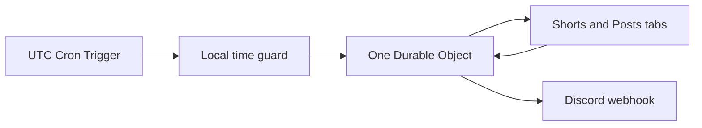

# Discord Reminder System

[](https://github.com/ChardXBT/Discord-Reminder-System/actions/workflows/ci.yml)
[](LICENSE)
[](https://developers.cloudflare.com/workers/)

**One YouTube channel. One Discord channel. Direct links with image previews.**

A small, open-source Cloudflare Worker that checks a channel's **Shorts** and **Community posts** and announces newly observed content through a Discord webhook:

```text
New content:
https://www.youtube.com/shorts/VIDEO_ID
```

Community announcements use `https://www.youtube.com/post/POST_ID`. Every message includes a clickable embed: Shorts show a video thumbnail, and image posts show the largest available preview of their first image. Text and poll posts still include the direct link. The Worker references YouTube's hosted images without downloading media or uploading attachments.

Mentions are disabled by default. Set the optional `DISCORD_MENTION_USER_ID` in your private configuration to ping one specific Discord account with **“@user new post”** or **“@user new video”** above the link and preview. Other users, roles, and `@everyone` cannot be pinged by these messages.

There are no application runtime dependencies, YouTube API keys, Gateway bots, or servers to maintain. Once deployed, your computer can be off.

> **Reliability boundaries:** YouTube Community data is undocumented and detection is best effort. Discord webhooks have no idempotency key: uncertain deliveries are retained for human review rather than retried automatically. Read [delivery guarantees](#delivery-guarantees) before deploying.

## How it works



1. A UTC Cron Trigger wakes the Worker. An IANA timezone guard determines whether a configured local window is open.
2. One SQLite-backed Durable Object serializes checks and scans both public YouTube tabs, including pagination.
3. The first complete scan records existing IDs silently. Later scans queue every unseen ID, regardless of its position in the feed.
4. Delivery state is saved before and after each webhook request. Successfully scanned windows are not fetched again while queued deliveries continue.

Both URLs must have the same channel path; the resolved YouTube channel IDs must also match. The channel identity and webhook identity are retained to prevent accidentally reusing state for a different setup.

## Quick start

You need **Node.js 22.13 or later** (Node.js 24 LTS recommended), a Cloudflare account, and permission to create a webhook in the destination Discord channel.

### 1. Install and verify

```sh
git clone https://github.com/ChardXBT/Discord-Reminder-System.git
cd Discord-Reminder-System
npm ci
npm test
```

### 2. Create private deployment configuration

```sh
cp wrangler.example.jsonc wrangler.private.jsonc
```

`cp` also works in PowerShell. The private file is gitignored. Edit its Worker `name` and configuration variables; keep the Durable Object binding and migration declarations.

| Setting | Purpose | Public example |
| --- | --- | --- |
| `SHORTS_URL` | Channel's Shorts tab | `https://www.youtube.com/@Qlob/shorts` |
| `POSTS_URL` | Same channel's Posts tab | `https://www.youtube.com/@Qlob/posts` |
| `TIMEZONE` | IANA timezone for local schedules | `Europe/London` |
| `LOCAL_TIMES` | Comma-separated daily times in 24-hour format | `09:00,17:00` |
| `WINDOW_MINUTES` | How long a scheduled check may start or retry | `30` |
| `DISCORD_MENTION_USER_ID` | Optional numeric Discord User ID to ping | `""` (disabled) |
| `triggers.crons` | UTC wake-up frequency | `["*/5 * * * *"]` |

The example URLs refer to two tabs of **one channel**. Replace both together to monitor another channel. `/channel/UC…/shorts` and `/channel/UC…/posts` URLs are also supported; use matching paths instead of mixing a handle and channel ID.

Keep account IDs, deployment names, and your actual schedule in `wrangler.private.jsonc`. Keep webhook credentials out of configuration variables and source code.

To get a mention ID, enable Discord **Settings → Advanced → Developer Mode**, right-click the desired user's profile, and select **Copy User ID**. Use that numeric string, not a display name or username. Keep your actual ID in the private file. Discord notification delivery also depends on the user's notification settings.

### 3. Create the Discord webhook

In Discord, open the destination channel's **Edit Channel → Integrations → Webhooks**, create a webhook, and copy its URL. Use a normal text channel and the standard `https://discord.com/api/webhooks/…/…` URL. Forum/thread URLs are intentionally unsupported.

Authenticate Cloudflare, then enter the webhook at Wrangler's interactive secret prompt:

```sh
npx wrangler login
npx wrangler secret put DISCORD_WEBHOOK_URL --config wrangler.private.jsonc
```

If Wrangler offers to create the Worker because it does not exist yet, allow it. The secret is stored by Cloudflare; it is not committed to Git. Avoid putting it in command-line arguments, screenshots, or logs.

### 4. Deploy

```sh
npm run deploy
```

The SQLite namespace is created through the included migration. No database provisioning, database ID, or separate server is needed. `workers_dev` and preview URLs are disabled; this is a scheduled service with no public administration endpoint.

The **first successful scheduled scan sends nothing**. Check the `baseline` log entry, then publish new content and confirm a later eligible scan announces its direct URL.

For logs:

```sh
npx wrangler tail --config wrangler.private.jsonc
```

Keep the Worker name, `Reminder` class, namespace, migration history, and `single-channel` object name stable on subsequent deployments. Redeploying code preserves tracking state. Deleting the namespace or restoring an old database checkpoint can invalidate duplicate prevention.

Upgrading from the original link-only version adds image storage automatically and preserves existing IDs, sent messages, and pending deliveries. Old announcements are not resent merely because the format changed.

## Customize scheduling

### Daily local times, with daylight saving

Set `TIMEZONE` and `LOCAL_TIMES` in the private configuration. For example, `Europe/London` with `09:00,17:00` follows the appropriate seasonal UTC offsets automatically.

Leave a frequent UTC wake-up cron such as `*/5 * * * *`. The Worker returns before accessing YouTube or the Durable Object outside a local window. Within a window it scans once, retries failed source scans, and resumes safe queued deliveries on subsequent ticks.

Cloudflare does not guarantee exact-minute execution. The first eligible tick starts the check; `WINDOW_MINUTES` permits late starts and recovery. Use a cron interval shorter than the window, and allow cron changes time to propagate. The default window is 30 minutes, and the supported range is 1–120 minutes.

If the whole window is missed, the next eligible check catches up on content that remains publicly visible. Scans already in progress may finish after the window closes. Cross-midnight windows retain the previous day's schedule identity. A repeated fall-back time runs once; a spring-forward time that does not exist is skipped when no tick falls in its window. Prefer daytime schedules to avoid that ambiguity.

### Check on every Cron Trigger

Set `LOCAL_TIMES` to an empty string:

```json
"LOCAL_TIMES": ""
```

Then set `triggers.crons` to your desired frequency, such as `["*/30 * * * *"]` for every 30 minutes. This mode follows UTC cron events directly; `TIMEZONE` does not change their timing.

Manage triggers through the private Wrangler configuration and redeploy. Cloudflare also exposes Cron Triggers in the dashboard, but a later Wrangler deploy reapplies the configuration file. See [Cloudflare's Cron Trigger documentation](https://developers.cloudflare.com/workers/configuration/cron-triggers/).

## Delivery guarantees

| Situation | Behavior |
| --- | --- |
| First successful scan | Complete visible history becomes a silent baseline. |
| Multiple new Shorts/posts | Every unseen ID in the complete scan is queued. |
| Pin, edit, reorder, or reappear | A retained ID is never treated as new. |
| Concurrent ticks or code redeployment | One object serializes work; SQLite retains IDs and delivery state. |
| YouTube fetch/parser failure | No partial snapshot or source checkpoint is saved. A later eligible tick retries. |
| Discord rate limit (`429`) | Item remains pending with persisted `retry_after`. |
| Definitive Discord rejection, such as `403` or `404` | Item remains pending until the webhook is fixed. |
| Timeout, server error, lost confirmation, or interrupted send | Item becomes `uncertain`; it is never automatically replayed. Other items continue. |

**Webhook delivery cannot be guaranteed exactly once.** If Discord accepts a message but its response is lost, the Worker cannot determine whether retrying would duplicate it. This project chooses to avoid automatic duplicates, accepting that an uncertain item may require manual delivery.

Logs include the content ID for uncertain deliveries and return `needs-review`. Check the destination channel for that direct URL. If it is missing, post the same `New content: URL` message manually. The retained uncertainty record remains in storage; new content continues to be processed. Do not delete or rewind tracking state to force a retry.

Messages are sent in discovery order. Community pins and approximate publication times make exact chronological ordering unreliable. Image previews depend on YouTube's image URLs and Discord's image proxy; unavailable images do not remove the direct link. Multiple-image posts display their first image, and videos show a thumbnail rather than an uploaded or playable video.

## YouTube limitations

- **Undocumented Community endpoint.** The standard YouTube Data API does not provide a Community-post feed. This project reads public tab page data and YouTube's internal browse continuations. Layout changes, consent/login challenges, throttling, or datacenter-IP restrictions can stop detection. Verify source access from your deployed Worker; a successful local check does not prove Cloudflare can access the same pages.
- **Only publicly exposed content.** Private, members-only, deleted, geographically blocked, or temporarily hidden items cannot be recovered unless YouTube exposes them during a later scan. Content published and removed between checks can be missed. Previously inaccessible historical content that later becomes visible may be treated as newly observed; the web feed does not supply a reliable universal publication timestamp.
- **Pins use IDs, not feed order.** Every accessible page is scanned, and IDs are retained indefinitely. Moving a known post to the top does not announce it. A newly observed pinned post is handled like any other unseen ID.
- **Complete scans, bounded work.** Each invocation uses at most 48 external requests, leaving headroom below the Workers Free limit. Both archives must fit within that scan budget; oversized archives fail without saving a partial baseline. Individual responses are capped at 4 MiB and pagination at 100 pages per source. Larger archives require adapting the budget and reviewing the applicable plan limits.
- **Delivery bursts can span ticks.** Pending deliveries resume during the current window or the next eligible window. They are retained even if the corresponding item disappears from YouTube.

This is a small best-effort notifier, with explicit failure handling rather than silent claims of complete coverage.

## Free-tier use

SQLite-backed Durable Objects are available on the Workers Free plan. A single channel checked a few times daily should usually fit within the included request, compute, and storage allowances. Full archive scans and indefinite ID retention consume resources; frequent schedules or large archives can exceed allowances.

Cloudflare's limits and billing depend on the account plan. Review [Workers limits](https://developers.cloudflare.com/workers/platform/limits/) and [Durable Objects pricing](https://developers.cloudflare.com/durable-objects/platform/pricing/). Free-plan limits cause errors when exceeded; do not upgrade to a paid plan unless you accept its billing terms.

## Development and verification

```sh
npm test          # Builds with Wrangler, then runs unit and runtime integration tests
npm run build    # Cloudflare configuration and bundle check; does not deploy
npm run dev      # Local Worker with scheduled-trigger testing enabled
```

Tests use Node's standard test runner, real SQLite databases, and Cloudflare's workerd runtime through Miniflare. They cover source parsing and pagination, text/images/polls, safe image URLs, restricted user mentions, upgrades from link-only storage, pinned and reordered posts, initial startup, batches, duplicate prevention, DST, midnight windows, concurrency, storage failures, rate limits, uncertain delivery, and persistence across runtime restarts. Test outbound traffic is mocked; tests do not send Discord messages or access YouTube.

For local manual checks, put `DISCORD_WEBHOOK_URL="your webhook URL"` in a gitignored `.dev.vars` file. Use a separate test webhook, a private config with `LOCAL_TIMES` temporarily blank, and:

```sh
npx wrangler dev --test-scheduled --config wrangler.private.jsonc
```

Open `http://localhost:8787/__scheduled` to simulate a cron tick. Local storage is separate from production, so its first complete scan also creates a silent baseline. `.dev.vars` is for local development; it does not provision the production secret.

## Troubleshooting

| Symptom | What to check |
| --- | --- |
| No first announcement | Expected: startup silently records history. Look for `baseline`, then test with newly published content. |
| Nothing runs at a local time | Confirm timezone, `HH:MM` times, UTC cron interval, and window length. Check Cloudflare's scheduled invocation history. |
| Invalid webhook secret | Use the standard Discord URL with no query string; set `DISCORD_WEBHOOK_URL` through `wrangler secret put`. |
| Discord `401`, `403`, or `404` | Check webhook existence and channel permissions. Rotate the secret while retaining the same webhook ID when possible. |
| `rate-limited` or `pending` | The queue is retained; a later eligible tick continues. Short windows or infrequent cron ticks can defer delivery. |
| `needs-review` | Inspect Discord for the logged content ID. Uncertain items require the manual check described above. |
| Missing tab, page data, or recognized content | YouTube may have changed its response or blocked anonymous access. Tracking state is preserved; inspect and update the parser. |
| Request/page/response budget exceeded | The archive exceeds a safety limit. No partial source checkpoint was committed. Review the limits before adapting the scan budget. |
| Channel/webhook identity changed | Restore the original configuration. To intentionally track a different setup, deploy a new Worker with a new namespace and baseline. |

## Project layout

```text
src/config.js       URL validation and timezone scheduling
src/youtube.js      Public tab parsing and complete pagination
src/reminder.js     Durable tracking, queueing, and webhook delivery
src/worker.js       Cron handler and Durable Object entry point
tests/              Synthetic fixtures, SQLite tests, and runtime checks
wrangler.example.jsonc   Reusable public deployment template
```

Wrangler and Miniflare are pinned development dependencies. Miniflare uses the version bundled with the pinned Wrangler release. Private deployment files, secrets, build output, and local runtime state are gitignored.

## License

[MIT](LICENSE). Contributions that keep the single-channel setup small and reliable are welcome.

Protocol references: [Discord webhooks](https://docs.discord.com/developers/resources/webhook), [Cloudflare secrets](https://developers.cloudflare.com/workers/configuration/secrets/), and [YouTube tab renderer research in yt-dlp](https://github.com/yt-dlp/yt-dlp/blob/master/yt_dlp/extractor/youtube/_tab.py).
